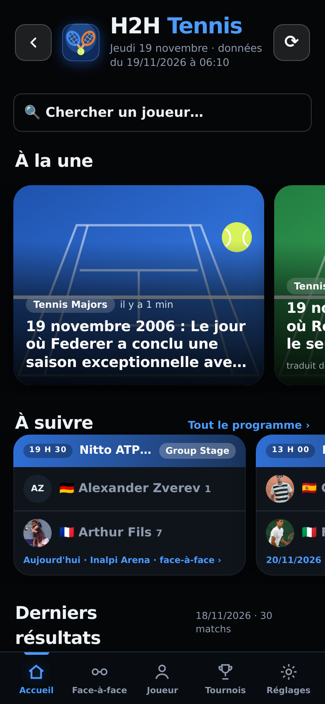

# Contrôle de l'appli

- Date (UTC) : 2026-11-27T22:41:53.018Z
- Version de l'appli : 0.11.0
- État : **OK**

## Erreurs
- aucune

## Alertes
- aucune

## Chiffres
```json
{
 "public": {
  "duree_chargement_s": 4.007,
  "chiffres": {
   "version_appli": "0.11.0",
   "matchs": 358058,
   "joueurs": 11902,
   "tournois": 10534,
   "doublons": 0,
   "complements_dechiffres": false,
   "classement": {
    "semaine": "2026-11-23",
    "source": "ATP, via Wikimedia Commons",
    "rangs": 2325,
    "top3": [
     [
      1,
      "Alexander Zverev",
      10350
     ],
     [
      2,
      "Jannik Sinner",
      7950
     ],
     [
      3,
      "Carlos Alcaraz",
      7600
     ]
    ]
   },
   "photos": 1192,
   "joueurs_avec_poids": 781,
   "sinner": {
    "nom": "Jannik Sinner",
    "matchs": 565,
    "photo": true
   },
   "depuis_juin": {
    "Challenger tableau": {
     "matchs": 3802,
     "score_complet": 2102,
     "stats": 0,
     "score_complet_pct": 55.3
    },
    "Challenger qualifications": {
     "matchs": 3039,
     "score_complet": 1803,
     "stats": 0,
     "score_complet_pct": 59.3
    },
    "ITF": {
     "matchs": 9955,
     "score_complet": 5813,
     "stats": 0,
     "score_complet_pct": 58.4
    },
    "ATP qualifications": {
     "matchs": 746,
     "score_complet": 368,
     "stats": 0,
     "score_complet_pct": 49.3
    },
    "ATP tableau": {
     "matchs": 1188,
     "score_complet": 1150,
     "stats": 0,
     "score_complet_pct": 96.8
    }
   }
  }
 },
 "complet": {
  "duree_chargement_s": 3.193,
  "chiffres": {
   "version_appli": "0.11.0",
   "matchs": 358540,
   "joueurs": 11916,
   "tournois": 10535,
   "doublons": 0,
   "complements_dechiffres": true,
   "classement": {
    "semaine": "2026-11-23",
    "source": "ATP, via Wikimedia Commons",
    "rangs": 2325,
    "top3": [
     [
      1,
      "Alexander Zverev",
      10350
     ],
     [
      2,
      "Jannik Sinner",
      7950
     ],
     [
      3,
      "Carlos Alcaraz",
      7600
     ]
    ]
   },
   "photos": 1192,
   "joueurs_avec_poids": 781,
   "sinner": {
    "nom": "Jannik Sinner",
    "matchs": 565,
    "photo": true
   },
   "depuis_juin": {
    "Challenger tableau": {
     "matchs": 3920,
     "score_complet": 3912,
     "stats": 3633,
     "score_complet_pct": 99.8
    },
    "Challenger qualifications": {
     "matchs": 3132,
     "score_complet": 3128,
     "stats": 2661,
     "score_complet_pct": 99.9
    },
    "ITF": {
     "matchs": 10177,
     "score_complet": 10145,
     "stats": 4234,
     "score_complet_pct": 99.7
    },
    "ATP qualifications": {
     "matchs": 777,
     "score_complet": 774,
     "stats": 753,
     "score_complet_pct": 99.6
    },
    "ATP tableau": {
     "matchs": 1203,
     "score_complet": 1203,
     "stats": 1183,
     "score_complet_pct": 100
    }
   }
  }
 }
}
```

## Captures (sans code, données publiques)
   