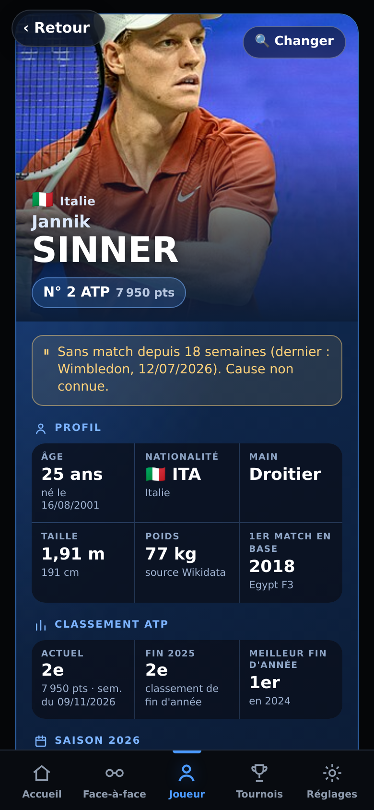
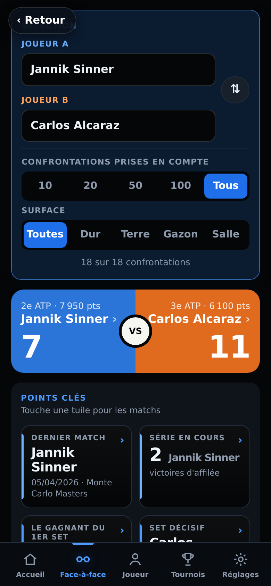
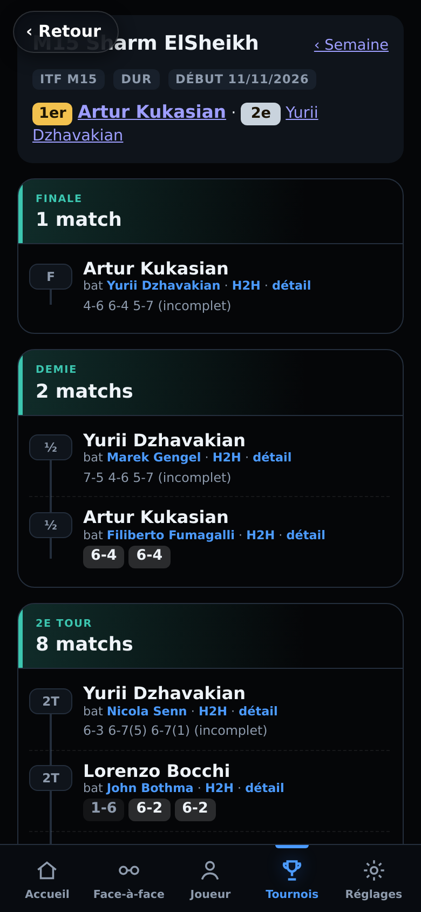

# Contrôle de l'appli

- Date (UTC) : 2026-11-17T06:08:05.202Z
- Version de l'appli : 0.11.0
- État : **OK**

## Erreurs
- aucune

## Alertes
- aucune

## Chiffres
```json
{
 "public": {
  "duree_chargement_s": 3.82,
  "chiffres": {
   "version_appli": "0.11.0",
   "matchs": 356883,
   "joueurs": 11861,
   "tournois": 10503,
   "doublons": 0,
   "complements_dechiffres": false,
   "classement": {
    "semaine": "2026-11-09",
    "source": "ATP, via Wikimedia Commons",
    "rangs": 2315,
    "top3": [
     [
      1,
      "Alexander Zverev",
      9320
     ],
     [
      2,
      "Jannik Sinner",
      7950
     ],
     [
      3,
      "Carlos Alcaraz",
      6100
     ]
    ]
   },
   "photos": 1192,
   "joueurs_avec_poids": 781,
   "sinner": {
    "nom": "Jannik Sinner",
    "matchs": 565,
    "photo": true
   },
   "depuis_juin": {
    "Challenger tableau": {
     "matchs": 3445,
     "score_complet": 1933,
     "stats": 0,
     "score_complet_pct": 56.1
    },
    "Challenger qualifications": {
     "matchs": 2850,
     "score_complet": 1693,
     "stats": 0,
     "score_complet_pct": 59.4
    },
    "ITF": {
     "matchs": 9339,
     "score_complet": 5478,
     "stats": 0,
     "score_complet_pct": 58.7
    },
    "ATP qualifications": {
     "matchs": 746,
     "score_complet": 368,
     "stats": 0,
     "score_complet_pct": 49.3
    },
    "ATP tableau": {
     "matchs": 1175,
     "score_complet": 1139,
     "stats": 0,
     "score_complet_pct": 96.9
    }
   }
  }
 },
 "complet": {
  "duree_chargement_s": 3.031,
  "chiffres": {
   "version_appli": "0.11.0",
   "matchs": 357369,
   "joueurs": 11871,
   "tournois": 10504,
   "doublons": 0,
   "complements_dechiffres": true,
   "classement": {
    "semaine": "2026-11-09",
    "source": "ATP, via Wikimedia Commons",
    "rangs": 2315,
    "top3": [
     [
      1,
      "Alexander Zverev",
      9320
     ],
     [
      2,
      "Jannik Sinner",
      7950
     ],
     [
      3,
      "Carlos Alcaraz",
      6100
     ]
    ]
   },
   "photos": 1192,
   "joueurs_avec_poids": 781,
   "sinner": {
    "nom": "Jannik Sinner",
    "matchs": 565,
    "photo": true
   },
   "depuis_juin": {
    "Challenger tableau": {
     "matchs": 3582,
     "score_complet": 3578,
     "stats": 3323,
     "score_complet_pct": 99.9
    },
    "Challenger qualifications": {
     "matchs": 2942,
     "score_complet": 2939,
     "stats": 2533,
     "score_complet_pct": 99.9
    },
    "ITF": {
     "matchs": 9545,
     "score_complet": 9516,
     "stats": 4234,
     "score_complet_pct": 99.7
    },
    "ATP qualifications": {
     "matchs": 777,
     "score_complet": 774,
     "stats": 753,
     "score_complet_pct": 99.6
    },
    "ATP tableau": {
     "matchs": 1192,
     "score_complet": 1192,
     "stats": 1172,
     "score_complet_pct": 100
    }
   }
  }
 }
}
```

## Captures (sans code, données publiques)
   