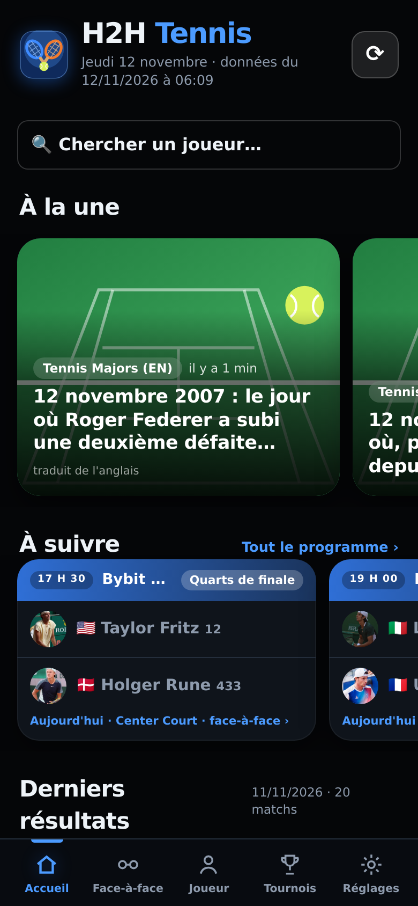
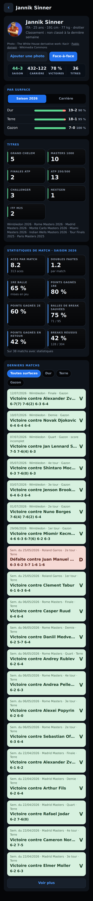
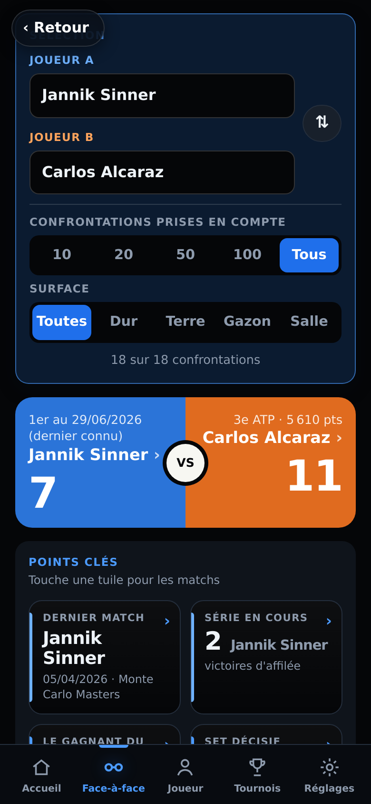
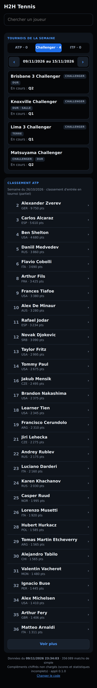

# Contrôle de l'appli

- Date (UTC) : 2026-11-12T06:10:13.573Z
- Version de l'appli : 0.10.0
- État : **OK**

## Erreurs
- aucune

## Alertes
- aucune

## Chiffres
```json
{
 "public": {
  "duree_chargement_s": 4.338,
  "chiffres": {
   "version_appli": "0.10.0",
   "matchs": 356326,
   "joueurs": 11829,
   "tournois": 10494,
   "doublons": 0,
   "complements_dechiffres": false,
   "classement": {
    "semaine": "2026-11-02",
    "source": "ATP, via Wikimedia Commons",
    "rangs": 2301,
    "top3": [
     [
      1,
      "Alexander Zverev",
      9550
     ],
     [
      2,
      "Jannik Sinner",
      9450
     ],
     [
      3,
      "Carlos Alcaraz",
      6100
     ]
    ]
   },
   "photos": 1192,
   "joueurs_avec_poids": 781,
   "sinner": {
    "nom": "Jannik Sinner",
    "matchs": 565,
    "photo": true
   },
   "depuis_juin": {
    "Challenger tableau": {
     "matchs": 3368,
     "score_complet": 1896,
     "stats": 0,
     "score_complet_pct": 56.3
    },
    "Challenger qualifications": {
     "matchs": 2734,
     "score_complet": 1625,
     "stats": 0,
     "score_complet_pct": 59.4
    },
    "ITF": {
     "matchs": 8989,
     "score_complet": 5281,
     "stats": 0,
     "score_complet_pct": 58.7
    },
    "ATP qualifications": {
     "matchs": 742,
     "score_complet": 365,
     "stats": 0,
     "score_complet_pct": 49.2
    },
    "ATP tableau": {
     "matchs": 1165,
     "score_complet": 1133,
     "stats": 0,
     "score_complet_pct": 97.3
    }
   }
  }
 },
 "complet": {
  "duree_chargement_s": 3.473,
  "chiffres": {
   "version_appli": "0.10.0",
   "matchs": 356942,
   "joueurs": 11852,
   "tournois": 10495,
   "doublons": 0,
   "complements_dechiffres": true,
   "classement": {
    "semaine": "2026-11-02",
    "source": "ATP, via Wikimedia Commons",
    "rangs": 2301,
    "top3": [
     [
      1,
      "Alexander Zverev",
      9550
     ],
     [
      2,
      "Jannik Sinner",
      9450
     ],
     [
      3,
      "Carlos Alcaraz",
      6100
     ]
    ]
   },
   "photos": 1192,
   "joueurs_avec_poids": 781,
   "sinner": {
    "nom": "Jannik Sinner",
    "matchs": 565,
    "photo": true
   },
   "depuis_juin": {
    "Challenger tableau": {
     "matchs": 3491,
     "score_complet": 3458,
     "stats": 3233,
     "score_complet_pct": 99.1
    },
    "Challenger qualifications": {
     "matchs": 2805,
     "score_complet": 2691,
     "stats": 2417,
     "score_complet_pct": 95.9
    },
    "ITF": {
     "matchs": 9357,
     "score_complet": 9237,
     "stats": 4234,
     "score_complet_pct": 98.7
    },
    "ATP qualifications": {
     "matchs": 773,
     "score_complet": 765,
     "stats": 750,
     "score_complet_pct": 99
    },
    "ATP tableau": {
     "matchs": 1185,
     "score_complet": 1185,
     "stats": 1165,
     "score_complet_pct": 100
    }
   }
  }
 }
}
```

## Captures (sans code, données publiques)
   